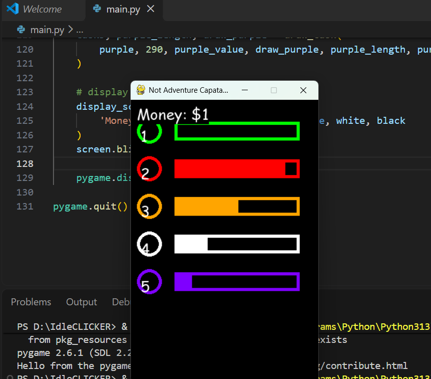

# Idle Clicker Game

A simple idle clicker game built using **Python and Pygame**. Players click on different colored task buttons to activate progress bars. Once a progress bar reaches its maximum length, the player earns money based on the task's value.

## Features

- Five different colored tasks.
- Click-based task activation.
- Individual progress bars for each task.
- Different loading speeds for each task.
- Different monetary rewards.
- Real-time money/score display.
- Simple interface built with Pygame.

## Technologies Used

- Python 3
- Pygame

## Project Structure

```text
IdleCLICKER/
│
└── main.py
```

## Installation

**1. Clone the repository**

```bash
git clone <your-repository-url>
```

**2. Navigate to the project directory**

```bash
cd IdleCLICKER
```

**3. Install Pygame**

```bash
pip install pygame
```

**4. Run the game**

```bash
python main.py
```

## Game Mechanics

The game contains five tasks, each with its own reward and progress speed.

| Task | Reward | Loading Speed |
|---|---:|---:|
| Green | $1 | 2 |
| Red | $2 | 1.5 |
| Orange | $3 | 1 |
| White | $4 | 0.75 |
| Purple | $5 | 0.5 |

### How to Play

1. Launch the game.
2. Click on any colored circle to activate its corresponding task.
3. The progress bar starts filling automatically.
4. Once the progress bar reaches its maximum length, you earn the corresponding reward.
5. Activate multiple tasks to earn money simultaneously.
6. Your total money is displayed at the top of the screen.

## Future Improvements

- Add upgrades to increase task speeds.
- Implement automatic task generation.
- Add saving and loading of player progress.
- Introduce additional tasks and rewards.
- Add sound effects and background music.
- Create a proper upgrade shop.

## Author

Developed as a Python and Pygame practice project.

## License

This project is open-source and available for learning and educational purposes.


